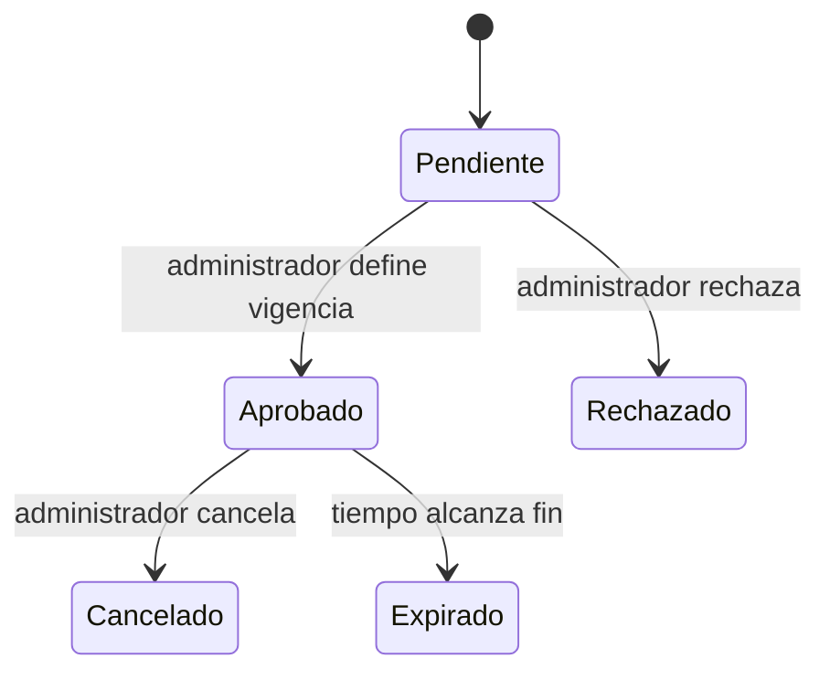

# Procesos y estados

## CU-01 · Consultar lugar

Visitante abre directorio → solicita categorías/lugares → API filtra activos → aplicación presenta lista → selecciona lugar → detalle muestra contactos, horarios y coordenadas → mapa sitúa el lugar. Sin GPS se conserva consulta y mapa; cercanía no es un requisito previo.

Errores: fallo de red con reintento; colección vacía con mensaje; lugar inactivo con 404. No mostrar información inventada cuando faltan horarios.

## CU-02 · Publicar mensaje

Actor autenticado activo elige foro → escribe → envía → servidor verifica identidad, foro, frecuencia y contenido → guarda autor desde sesión → devuelve 201 → pantalla incorpora mensaje. El cliente nunca elige un autor ajeno.

Errores: 401 sesión inválida; 403 usuario inactivo; 422 contenido; 429 frecuencia. El formulario conserva texto ante error de red. No hacer reintentos automáticos de POST sin una estrategia de duplicados.

## CU-03 · Destacar mensaje

Autor solicita sobre mensaje propio activo → solicitud pendiente → administrador revisa → rechaza o aprueba con fechas → API determina vigencia → al vencer se presenta como mensaje normal. Cancelación y moderación eliminan prioridad.

Expirado es estado efectivo derivado de fechas. Aprobado puede estar programado y aún no vigente. Transiciones se validan en servidor y transacción.

## CU-04 · Administrar

Administrador autenticado valida datos → modifica categoría/lugar/horario o visibilidad de mensaje → servidor autoriza → guarda → se refleja en lectura pública. Desactivar antes que borrar físicamente.

## Estados Flutter

Lectura: inicial → cargando → datos/vacío/error; reintento vuelve a cargando.
Formulario: edición → enviando → éxito/error. Impedir envíos repetidos mientras está enviando.

## CU-05 · Denunciar y revisar un mensaje (acordado; no implementado)

Usuario autenticado selecciona un mensaje → elige motivo y añade comentario opcional → envía denuncia → moderador revisa mensaje y denuncia → descarta o toma medidas (borrado lógico del mensaje y/o timeout) → sistema conserva la decisión. Denunciar no retira automáticamente el mensaje ni sanciona al autor.

El timeout impide publicar en los cuatro chats durante 10 minutos, 1 hora, 24 horas o 7 días; permite leer y usar el mapa. Al finalizar cesa la restricción temporal, siempre sujeto a las demás reglas vigentes.

Pendientes de especificación: catálogo de motivos, duplicados, estados y visibilidad de la resolución; levantamiento por moderador y superposición de timeouts. El levantamiento administrativo y los límites de jerarquía ya están acordados.

## CU-06 · Solicitar cambios del mapa (acordado; no implementado)

Moderador crea ticket de alta, corrección de datos o cierre/inexistencia → administrador revisa → aprueba o rechaza con motivo → moderador consulta estado y decisión. La solicitud no modifica directamente los datos publicados. El administrador revisa los datos propuestos antes de confirmar. Aprobar aplica los datos y registra la resolución en una sola transacción; un fallo revierte la operación y mantiene el ticket pendiente. Rechazar no modifica el lugar. Estados: pendiente, aprobado y rechazado. Falta definir campos por tipo de solicitud.
